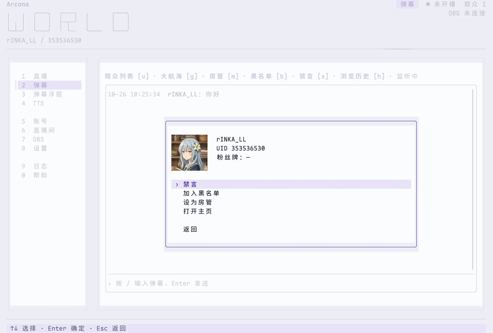
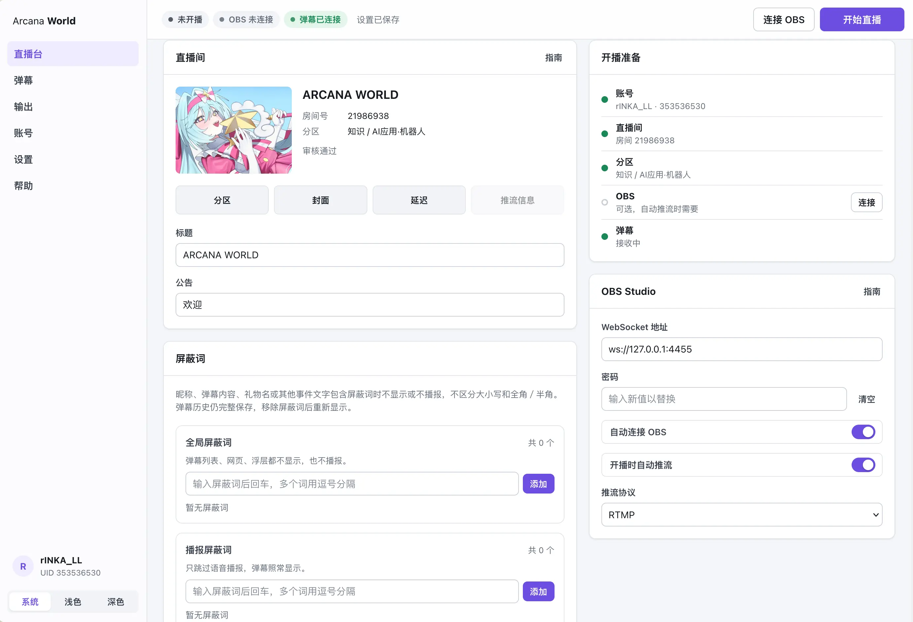
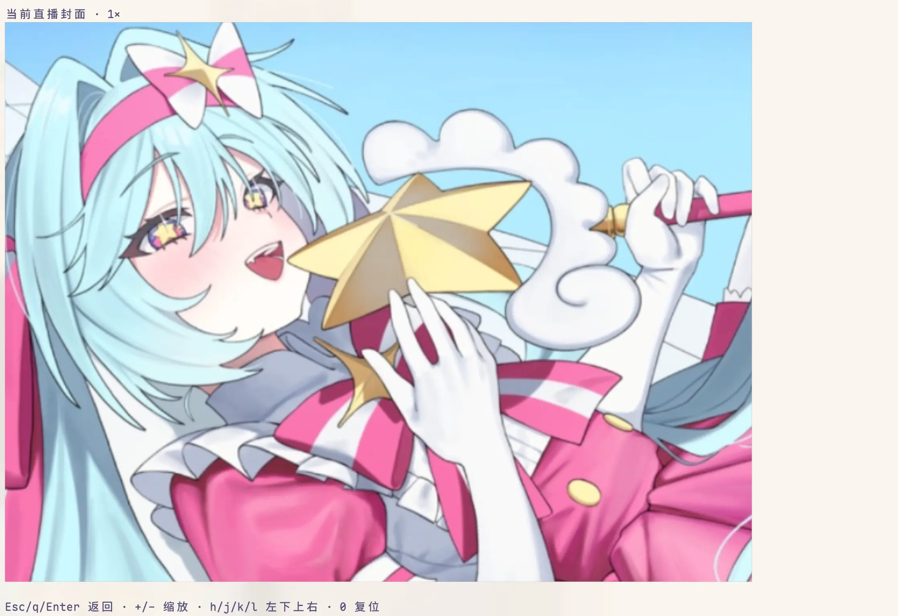

# Arcana World

<p align="center">
  
</p>

[](https://github.com/TarocchiLive/arcana-world/actions/workflows/ci.yml)
[](https://go.dev/)
[](LICENSE)
[](https://github.com/TarocchiLive/arcana-world/releases/latest)

[中文](README.md) · **English**

Arcana World is a Go-based bilibili live streaming and chat client.

It supports mobile QR-code sign-in, a floating chat overlay, and speech announcements across platforms.

Native support for Windows, Linux, and macOS.

## Preview

<p align="center">
  
  
  
  
</p>

## Highlights

- **Scan to sign in, connect OBS, and go live with one click.**
- **Browse and send live chat in real time, with a click-through floating overlay that stays out of the way of your mouse and keyboard.**
- **Chat, gift, and Super Chat announcements with Edge, Qwen, and Doubao cloud voices, or MeloTTS, Kokoro, and Piper local voices.**
- **Typical memory usage of 40 MB: lightweight, smooth, and stable.**
- **Optional local Web control panel.**

## Install

### Quick start

Download the [latest release](https://github.com/TarocchiLive/arcana-world/releases/latest) for your platform, such as `arcana-world-windows-amd64.zip`, and extract the entire archive. Run `arcana-world` at its root (`arcana-world.exe` on Windows) to use your saved default interface, or the terminal interface if none is set. Windows users can also run `arcana-world-webui.exe` in the same directory to open the browser interface directly.

### Windows (Scoop)

```powershell
scoop bucket add tarocchilive https://github.com/TarocchiLive/scoop-bucket
scoop install tarocchilive/arcana-world
```

### Debian / Ubuntu (APT)

Supports amd64 and arm64.

```sh
sudo apt-get update
sudo apt-get install -y ca-certificates curl
sudo install -d -m 0755 /etc/apt/keyrings
curl -fsSL https://tarocchilive.github.io/apt/tarocchilive-archive-keyring.gpg | sudo tee /etc/apt/keyrings/tarocchilive.gpg >/dev/null
sudo chmod 0644 /etc/apt/keyrings/tarocchilive.gpg
echo "deb [arch=$(dpkg --print-architecture) signed-by=/etc/apt/keyrings/tarocchilive.gpg] https://tarocchilive.github.io/apt stable main" | sudo tee /etc/apt/sources.list.d/tarocchilive.list
sudo apt-get update
sudo apt-get install arcana-world
```

### Build from source

Building from source requires Go 1.26.8+ and the platform's [overlay build dependencies](cmd/arcana-world-overlay/README.en.md#build-and-launch). `make desktop` also builds the speech helper, which needs Python 3 and a C compiler; its GPU runtime is downloaded as a verified prebuilt pack listed in `scripts/native-deps.json` when available, and building it from source also needs CMake 3.24+, Ninja, and a C++ compiler. On Linux it also needs ALSA development libraries and `pkg-config` (`libasound2-dev pkg-config` on Debian/Ubuntu). See `bash scripts/build.sh --help` for each platform's compiler requirements:

```sh
git clone https://github.com/TarocchiLive/arcana-world.git
cd arcana-world
make desktop
./bin/arcana-world
```

NixOS:
```sh
nix build
./result/bin/arcana-world
```

After building, run `bin/arcana-world` (`bin/arcana-world.exe` on Windows). For terminal-only use without the overlay or speech, build with `make build`; no graphics or speech dependencies are needed. See [Arcana World Overlay](cmd/arcana-world-overlay/README.en.md#supported-platforms) for overlay platform support.

## Help

In the terminal interface, press `0` for help. In the Web panel, use Help in the top navigation to search topics and read articles directly. Run `arcana-world --help` for command-line options.

### RTMPSRT streaming

RTMPSRT needs the [libsrt](https://github.com/Haivision/srt) 1.5 runtime. Skip it if you do not use this protocol:

- macOS: `brew install srt`
- Linux: install your distribution's libsrt 1.5 package, such as `libsrt1.5-openssl` on Debian / Ubuntu
- Windows: put `srt.dll` and its dependent DLLs, built for the same architecture as the app, in the `lib` folder next to the executable; vcpkg's `srt` package can build them

Then choose `RTMPSRT` as the streaming protocol in Settings, connect OBS on this computer, and start live. OBS streams to a local address and the app forwards it to Bilibili, so keep the app running and OBS connected while you stream; disconnecting OBS or quitting the app stops the stream. If Bilibili does not provide an RTMPSRT URL, the app reports an error; stop live and switch to another protocol.

To bundle the runtime into a source build, see `bash scripts/build.sh --help`.

### Speech

Speech can use Edge, Qwen, or Doubao online voices, or MeloTTS, Kokoro, or Piper local voices. On the TTS page, choose a voice provider and open its settings (in WebUI: Outputs → Voice). Preview it to make sure you can hear it, then turn speech on.

Edge is free and works as soon as you pick a voice. Qwen and Doubao need your own API key. Local voices download a model the first time and then work offline. See the [speech guide](cmd/arcana-world-tts/README.en.md) for setting up keys, installing models yourself, and troubleshooting.

## TODO
- [x] Fetch direct Bilibili stream URLs, connect to OBS, and start broadcasts automatically.
- [x] Receive Bilibili live chat messages and browse gifts and chat history in the TUI.
- [x] Add a Bilibili live chat overlay.
- [x] Add TTS chat readouts and gift announcements.
- [x] Switch the overlay between monitors without restarting.
- [x] Add mouse support to the TUI.
- [x] Refactor and improve the TUI layout and appearance.
- [x] Send live chat messages from the terminal.
- [x] Refactor and improve the overlay layout and appearance.
- [x] Support the iTerm2 image protocol for cover previews.
- [x] Support resizing and cropping cover images in the terminal.
- [x] Check for new versions.
- [x] Support Scoop and APT repositories.
- [ ] Support Homebrew and nixpkgs repositories.
- [ ] Add a bot protocol interface.
- [x] Optional WebUI control panel.
- [?] Native GUI support (under consideration).

## Development

```sh
make run    # Run locally
make check  # Run tests and static checks
make build  # Build
```

Translations live in [`internal/i18n/locales`](internal/i18n/locales), grouped by language and module. Report problems through [Issues](https://github.com/TarocchiLive/arcana-world/issues), or contribute a Pull Request.

## Statement

This project is an independently developed open-source tool. Follow applicable laws, regulations, and platform rules. Use it only to learn about and exchange knowledge on Go and related frameworks.

## License

Licensed under [GPL-3.0-only](LICENSE).

## Acknowledgments

- [Radekyspec/StartLive](https://github.com/Radekyspec/StartLive)
- [Bubble Tea](https://github.com/charmbracelet/bubbletea)
- [Kotonoha](https://github.com/locez/kotonoha)
- [Bubbles](https://github.com/charmbracelet/bubbles)
- [Lip Gloss](https://github.com/charmbracelet/lipgloss)
- [edge-tts](https://github.com/rany2/edge-tts)
- [Haivision SRT](https://github.com/Haivision/srt)
- [sherpa-onnx](https://github.com/k2-fsa/sherpa-onnx), [ONNX Runtime](https://github.com/microsoft/onnxruntime), and [MeloTTS](https://github.com/myshell-ai/MeloTTS)
- [Kokoro](https://huggingface.co/hexgrad/Kokoro-82M-v1.1-zh), [Piper](https://github.com/rhasspy/piper), [LJ Speech](https://keithito.com/LJ-Speech-Dataset/), and [eSpeak NG](https://github.com/espeak-ng/espeak-ng)
