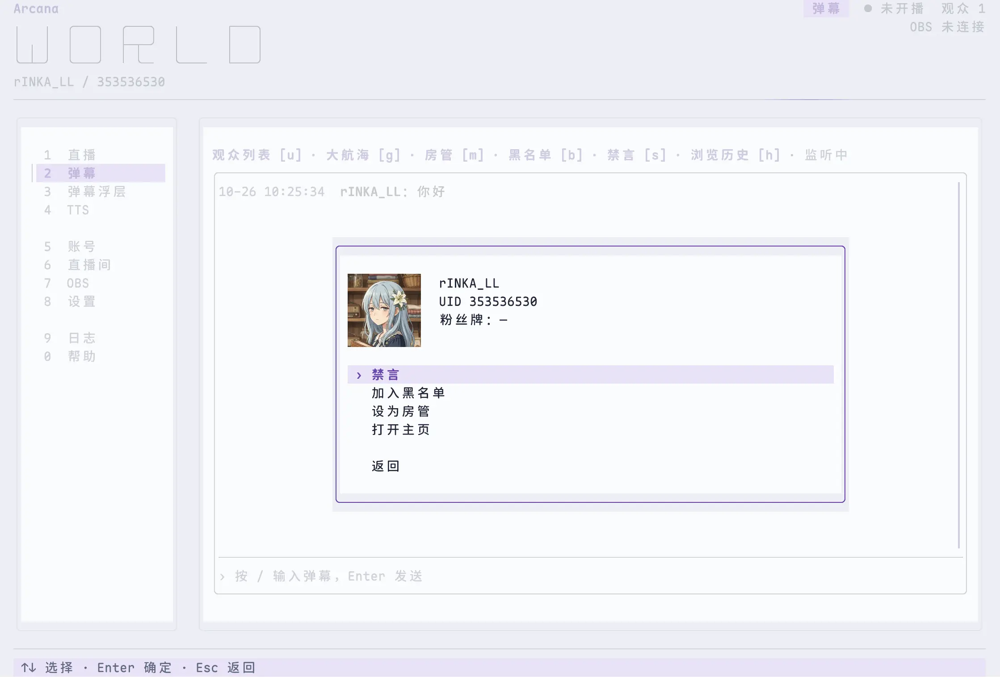
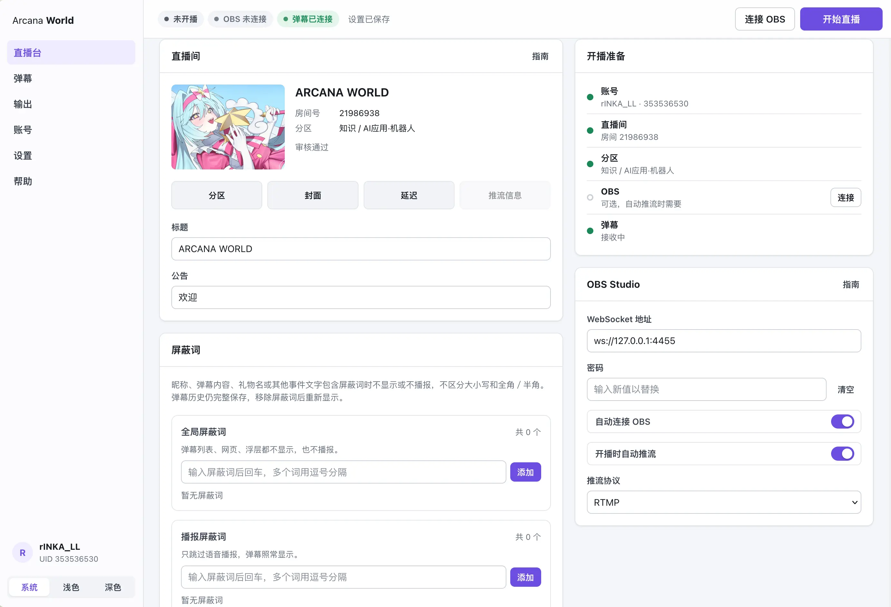
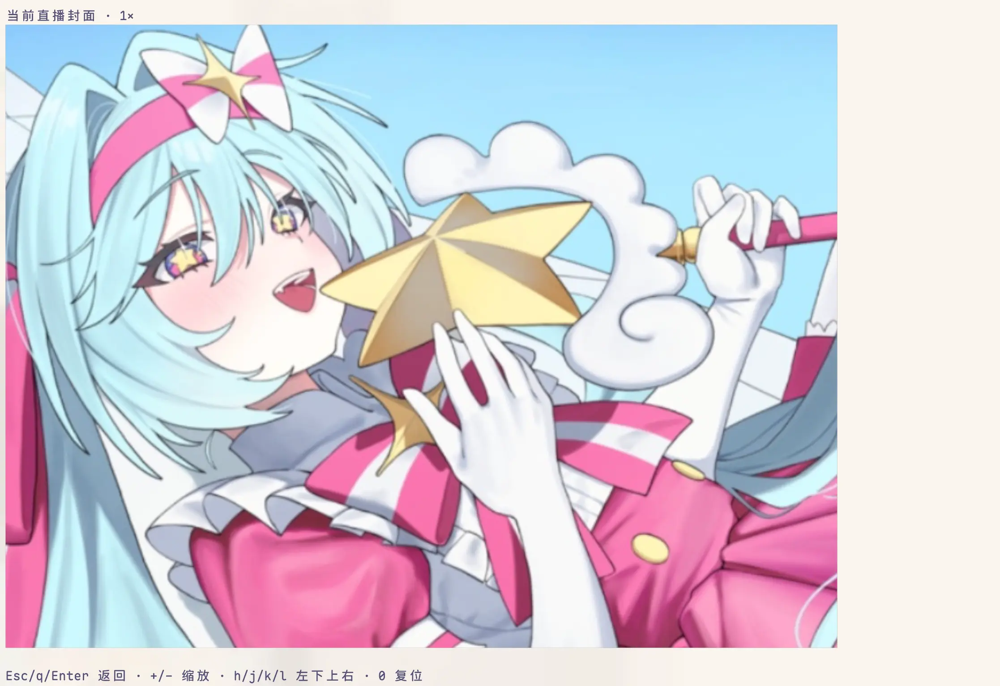
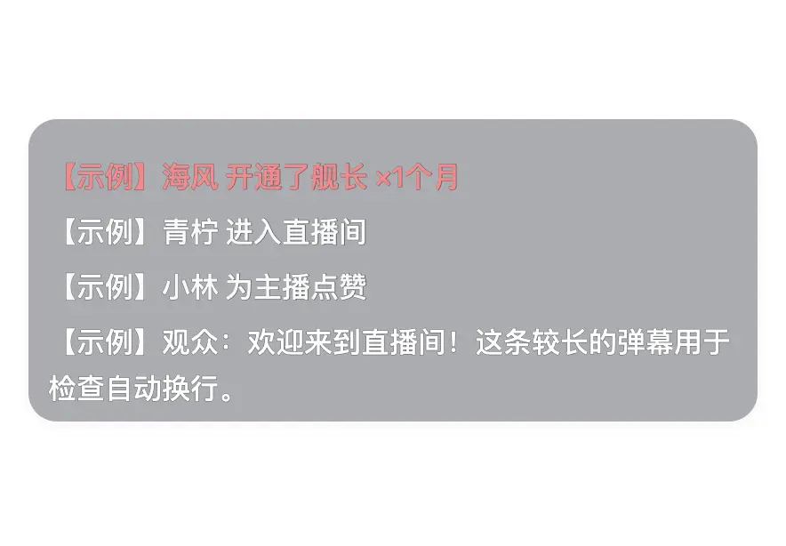

# Arcana World

<p align="center">
  
</p>

[](https://github.com/TarocchiLive/arcana-world/actions/workflows/ci.yml)
[](https://go.dev/)
[](LICENSE)
[](https://github.com/TarocchiLive/arcana-world/releases/latest)
[](https://tarocchilive.github.io/arcana-world/)

[中文](README.md) · **English**

Arcana World is a cross-platform bilibili live streaming and chat client for Windows, macOS, and Linux.

**[Documentation](https://tarocchilive.github.io/arcana-world/)** (Chinese only for now) · [Download](https://github.com/TarocchiLive/arcana-world/releases/latest) · [Troubleshooting](https://tarocchilive.github.io/arcana-world/reference/troubleshooting)

<p align="center">
  
  
  
  
</p>

## Features

- Scan to sign in, connect OBS, and go live with one click
- Real-time chat and moderation, with a click-through desktop chat overlay
- Chat, gift, and Super Chat announcements: Edge, Qwen, and Doubao cloud voices, or MeloTTS, Kokoro, and Piper local voices
- Terminal interface and local web panel, with typical memory usage around 40 MB
- WebSocket chat broadcast for OBS browser sources or your own scripts

## Install

Download the archive for your platform from the [latest release](https://github.com/TarocchiLive/arcana-world/releases/latest), extract it, and run `arcana-world` (`arcana-world.exe` on Windows, or `arcana-world-webui.exe` for the web panel).

Package managers are also available:

```powershell
# Windows (Scoop)
scoop bucket add tarocchilive https://github.com/TarocchiLive/scoop-bucket
scoop install tarocchilive/arcana-world
```

See [Install & update](https://tarocchilive.github.io/arcana-world/guide/install) for the Debian / Ubuntu APT repository, macOS quarantine removal, upgrading, and uninstalling.

## Build from source

```sh
git clone https://github.com/TarocchiLive/arcana-world.git
cd arcana-world
make build      # Terminal app only; needs Go 1.26.8+
make desktop    # Full desktop package with overlay and speech helpers
```

On NixOS, use `nix build`. See [Building from source](docs/building.md) for overlay and speech dependencies, and [Contributing](https://tarocchilive.github.io/arcana-world/development/) for development conventions.

## TODO

- [x] Fetch direct Bilibili stream URLs, connect to OBS, and start broadcasts automatically.
- [x] Receive Bilibili live chat messages and browse gifts and chat history in the TUI.
- [x] Add a Bilibili live chat overlay.
- [x] Add TTS chat readouts and gift announcements.
- [x] Switch the overlay between monitors without restarting.
- [x] Add mouse support to the TUI.
- [x] Refactor and improve the TUI layout and appearance.
- [x] Send live chat messages from the terminal.
- [x] Refactor and improve the overlay layout and appearance.
- [x] Support the iTerm2 image protocol for cover previews.
- [x] Support resizing and cropping cover images in the terminal.
- [x] Check for new versions.
- [x] Support Scoop and APT repositories.
- [ ] Support Homebrew and nixpkgs repositories.
- [ ] Add a bot protocol interface.
- [x] Optional WebUI control panel.
- [?] Native GUI support (under consideration).

## Feedback

Report problems or suggestions through [Issues](https://github.com/TarocchiLive/arcana-world/issues).

## Statement

This project is an independently developed open-source tool. Follow applicable laws, regulations, and platform rules. Use it only to learn about and exchange knowledge on Go and related frameworks.

## License

Licensed under [GPL-3.0-only](LICENSE).

## Acknowledgments

- [Radekyspec/StartLive](https://github.com/Radekyspec/StartLive)
- [Bubble Tea](https://github.com/charmbracelet/bubbletea)
- [Kotonoha](https://github.com/locez/kotonoha)
- [Bubbles](https://github.com/charmbracelet/bubbles)
- [Lip Gloss](https://github.com/charmbracelet/lipgloss)
- [edge-tts](https://github.com/rany2/edge-tts)
- [Haivision SRT](https://github.com/Haivision/srt)
- [sherpa-onnx](https://github.com/k2-fsa/sherpa-onnx), [ONNX Runtime](https://github.com/microsoft/onnxruntime), and [MeloTTS](https://github.com/myshell-ai/MeloTTS)
- [Kokoro](https://huggingface.co/hexgrad/Kokoro-82M-v1.1-zh), [Piper](https://github.com/rhasspy/piper), [LJ Speech](https://keithito.com/LJ-Speech-Dataset/), and [eSpeak NG](https://github.com/espeak-ng/espeak-ng)
