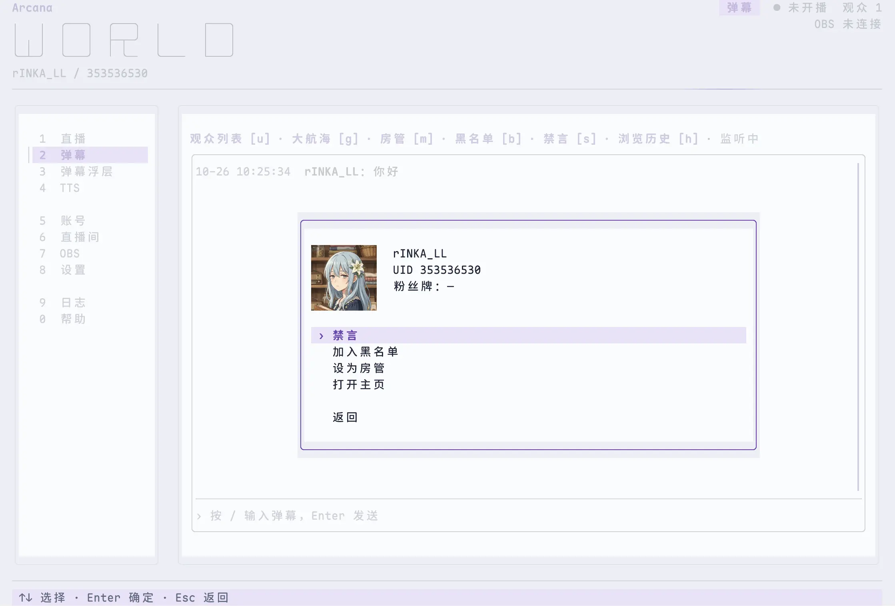
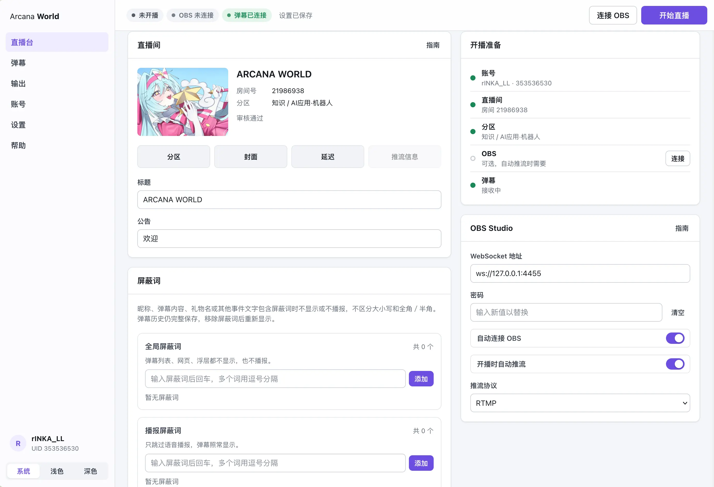
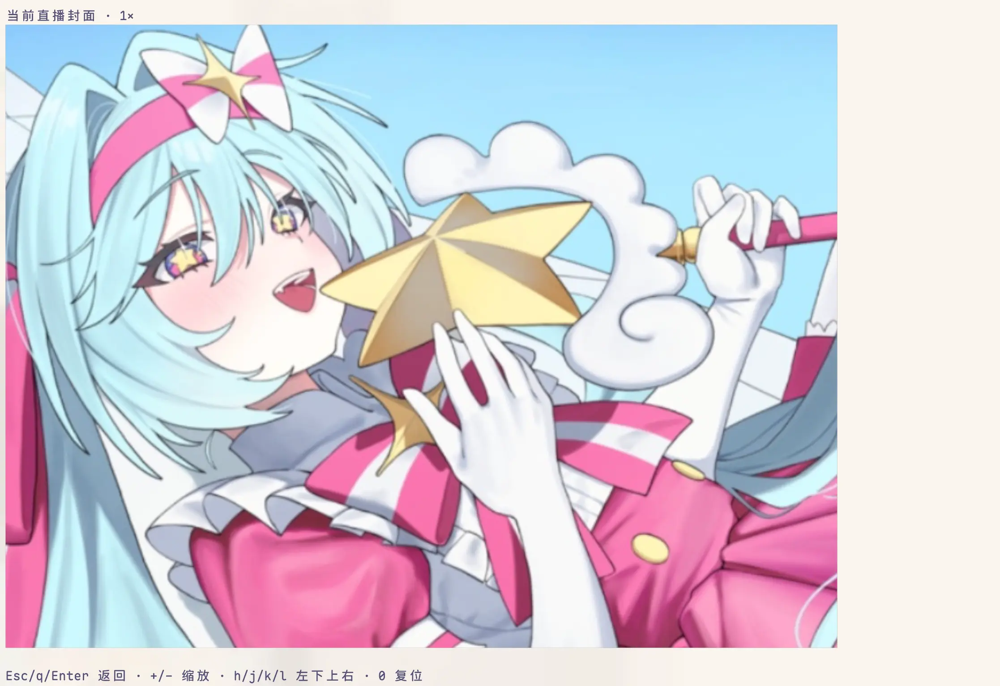
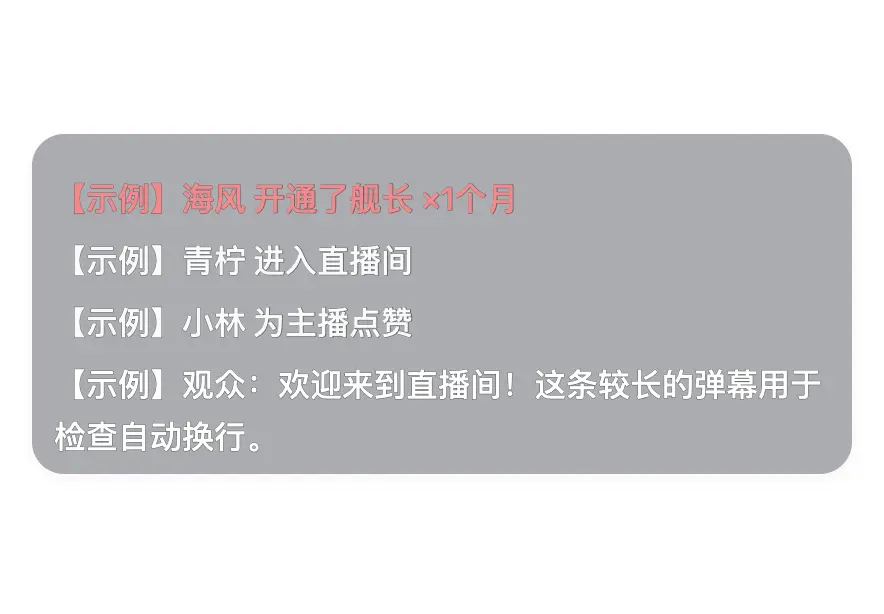
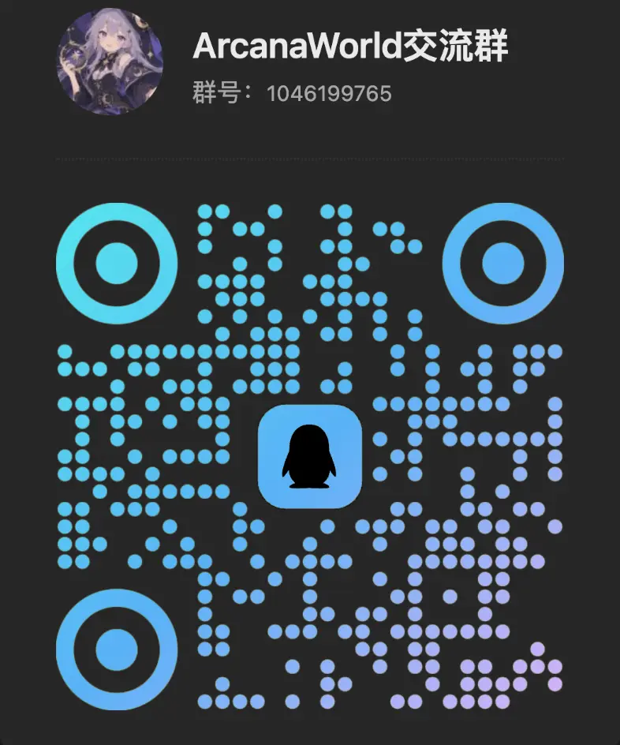

# Arcana World

<p align="center">
  
</p>

[](https://github.com/TarocchiLive/arcana-world/actions/workflows/ci.yml)
[](https://go.dev/)
[](LICENSE)
[](https://github.com/TarocchiLive/arcana-world/releases/latest)
[](https://tarocchilive.github.io/arcana-world/)
[](https://qm.qq.com/q/TkCteIVlOo)

**中文** · [English](README.en.md)

Arcana World 是跨平台的 bilibili 直播姬 + 弹幕姬，支持 Windows、macOS 和 Linux。

**[使用文档](https://tarocchilive.github.io/arcana-world/)** · [下载](https://github.com/TarocchiLive/arcana-world/releases/latest) · [常见问题](https://tarocchilive.github.io/arcana-world/reference/troubleshooting)

<p align="center">
  
  
  
  
</p>

## 功能

- 扫码登录，连接 OBS 后一键开播
- 实时弹幕收发与观众管理，鼠标可穿透的桌面弹幕浮层
- 弹幕、礼物和醒目留言语音播报：Edge、千问、豆包云端语音，MeloTTS、Kokoro、Piper 本地语音
- 终端界面与本机网页面板，常态内存占用约 40 MB
- WebSocket 弹幕广播，可接入 OBS 浏览器源或自定义脚本

## 安装

从 [最新版本](https://github.com/TarocchiLive/arcana-world/releases/latest) 下载对应平台的压缩包，解压后运行 `arcana-world`（Windows 为 `arcana-world.exe`，网页面板为 `arcana-world-webui.exe`）。

也可通过包管理器安装：

```powershell
# Windows（Scoop）
scoop bucket add tarocchilive https://github.com/TarocchiLive/scoop-bucket
scoop install tarocchilive/arcana-world
```

Debian / Ubuntu 的 APT 源、macOS 隔离标记处理、升级与卸载见[安装与升级](https://tarocchilive.github.io/arcana-world/guide/install)。

## 从源码构建

```sh
git clone https://github.com/TarocchiLive/arcana-world.git
cd arcana-world
make build      # 仅终端主程序，只需 Go 1.26.8+
make desktop    # 完整桌面包，含浮层和语音辅助程序
```

NixOS 使用 `nix build`。浮层和语音的构建依赖见[从源码构建](docs/building.md)，开发约定见[参与开发](https://tarocchilive.github.io/arcana-world/development/)。

## TODO

- [x] 支持获取 B 站推流直链，自动连接 OBS 并开播。
- [x] 支持 B 站直播间弹幕抓取，并在 TUI 中浏览礼物和聊天记录。
- [x] 支持 B 站直播间弹幕浮层。
- [x] 支持 TTS 朗读弹幕和礼物播报。
- [x] 多显示器浮层热切换。
- [x] 鼠标 tui 操作。
- [x] tui 界面重构美化。
- [x] 在终端发送弹幕。
- [x] 浮层界面重构美化。
- [x] 封面预览支持 iTerm2 图片协议。
- [x] 终端缩放裁剪封面图。
- [x] 版本更新检查。
- [x] Scoop、APT 软件仓库支持。
- [ ] Homebrew、nixpkgs 软件仓库支持。
- [ ] 机器人协议接口。
- [x] 可选 WebUI 控制面板。
- [?] 原生 GUI 支持（待定）。

## 交流与反馈

问题与建议请提交 [Issue](https://github.com/TarocchiLive/arcana-world/issues)，或加入 QQ 群：



## 声明

本项目是独立开发的开源工具。使用者应自行遵守适用的法律法规和平台规则。本项目仅用于学习和交流 Go 及相关框架，请勿用于其他用途。

## 许可证

采用 [GPL-3.0-only](LICENSE)。

## 致谢

- [Radekyspec/StartLive](https://github.com/Radekyspec/StartLive)
- [Bubble Tea](https://github.com/charmbracelet/bubbletea)
- [Kotonoha](https://github.com/locez/kotonoha)
- [Bubbles](https://github.com/charmbracelet/bubbles)
- [Lip Gloss](https://github.com/charmbracelet/lipgloss)
- [edge-tts](https://github.com/rany2/edge-tts)
- [Haivision SRT](https://github.com/Haivision/srt)
- [sherpa-onnx](https://github.com/k2-fsa/sherpa-onnx)、[ONNX Runtime](https://github.com/microsoft/onnxruntime)、[MeloTTS](https://github.com/myshell-ai/MeloTTS)
- [Kokoro](https://huggingface.co/hexgrad/Kokoro-82M-v1.1-zh)、[Piper](https://github.com/rhasspy/piper)、[LJ Speech](https://keithito.com/LJ-Speech-Dataset/)、[eSpeak NG](https://github.com/espeak-ng/espeak-ng)
