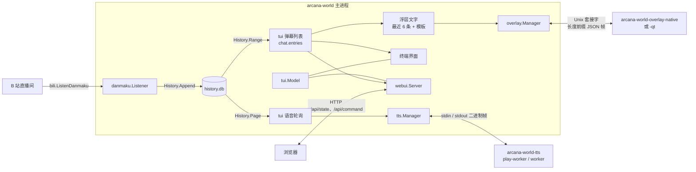

# 架构概览

这份文档面向要修改代码的贡献者，说明程序如何划分、数据怎么流动，以及改某类功能该去哪个包。构建与环境见 [从源码构建](building.md)，用户视角的说明见 [README](../README.md)。

## 可执行程序

| 程序 | 入口 | 职责 |
| --- | --- | --- |
| `arcana-world` | `cmd/arcana-world` | 主程序。解析命令行、打开数据目录，创建 `tui.Model`，按 `default_ui` 或 `--tui` / `--gui` 进入终端界面或 WebUI（`web.go`）；另含 `--doctor`（`doctor*.go`）和 `--check-update`（`update.go`） |
| `arcana-world-webui` | `cmd/arcana-world-webui` | 仅 Windows 的启动器（`main_windows.go`）。运行同目录的 `arcana-world.exe` 并追加 `--gui`，失败时弹出错误对话框 |
| `arcana-world-overlay` | `cmd/arcana-world-overlay` | 桌面文字浮层 helper。构建出 `arcana-world-overlay-native`（原生浮层）和 `arcana-world-overlay-qt`（精美浮层）两个文件 |
| `arcana-world-tts` | `cmd/arcana-world-tts` | 语音 helper。负责音频播放和本地模型合成 |

**浮层两种后端**由构建标签选择，入口文件同为 `main.go`：

- 原生浮层：`backend_native.go`（`!qt`），渲染代码在 `internal/overlay/native`，按平台分为 AppKit（`overlay_darwin.go`、`panel_darwin.m`）、Wayland layer-shell（`overlay_linux.go`、`wayland_linux.c`）和 Win32 分层窗口（`overlay_windows.go` 等）。
- 精美浮层：`backend_qt.go`（`qt` 标签），Go 侧桥接在 `internal/overlay/qt/qt.go`，Qt Widgets 实现在 `internal/overlay/qt/cpp`（`CMakeLists.txt`、`overlay.cpp`、`platform_*.cpp|mm`），编译为 `-lawqt` 库后链接进 helper。

**语音 helper** 带 `tts` 构建标签（`cmd/arcana-world-tts/main.go`、`internal/tts/audio`），本地合成使用 sherpa-onnx，需要 cgo（`internal/tts/meloworker/native.go`：`tts && cgo`）。子命令：

- `play-worker`：常驻进程，从 stdin 接收音频帧并播放。
- `worker`：常驻进程，加载一次本地模型，接收文本帧并返回 WAV。
- `play`：从 stdin 播放一段音频。

完整参数以 `arcana-world-tts --help` 为准，用户侧说明见 [语音播报](../cmd/arcana-world-tts/README.md)。

### 安装位置

helper 位于主程序旁的 `libexec/` 目录。`internal/helperpath` 先对主程序路径解析符号链接，再定位 helper；Windows 的可执行文件加 `.exe`，macOS 的 Qt helper 使用应用包内路径：

| 路径 | 内容 |
| --- | --- |
| `libexec/arcana-world-overlay-native` | 原生浮层 |
| `libexec/arcana-world-overlay-qt` | Linux、Windows 的精美浮层 |
| `libexec/Arcana World Elegant Overlay.app/Contents/MacOS/arcana-world-overlay-qt` | macOS 的精美浮层 |
| `libexec/arcana-world-tts` | 语音 helper，及其运行库 |

macOS 的 Qt 运行库位于该应用包的 `Contents/Frameworks`，平台插件位于 `Contents/PlugIns/platforms`，`qt.conf` 位于 `Contents/Resources`。主程序直接启动应用包内的可执行文件。

`arcana-world-webui.exe` 与 `arcana-world.exe` 同级，不在 `libexec`。`models/tts/` 同样在主程序旁，由 `internal/tts/models` 管理。构建目标与产物对应关系见 [从源码构建](building.md) 和 `scripts/build.sh`。

可选的 `libsrt` 不是 helper：`internal/rtmpsrt` 仅在选择 RTMPSRT 推流协议时，通过 purego 动态加载主程序旁 `lib/` 中的 `libsrt`（`load_unix.go`、`load_windows.go`）。

## 进程模型与通信

主程序是唯一的业务进程；浮层和语音 helper 都是它按需启动的子进程，由 `tui.Model` 持有句柄并负责回收。

### 浮层：套接字协议 v4

实现在 `internal/overlay`（`manager.go`、`host.go`、`protocol.go`），helper 端入口是 `overlay.Serve`。

1. `overlay.Start`（由 `tui.Model.startOverlay` 调用）确定 helper 路径：`-overlay-executable` 优先，否则 `bundledExecutable` 按 `arcana-world-overlay-<backend>` 在 `libexec` 中查找。
2. 在私有临时目录（`ipc_unix.go` / `ipc_windows.go`）创建 Unix 套接字，生成随机令牌，以环境变量 `ARCANA_OVERLAY_TOKEN` 传给子进程，并用 `journal.AddSecrets` 登记以便脱敏。helper 以 `-socket <路径>` 启动。
3. 帧格式是 4 字节大端长度加 UTF-8 JSON（`wireFrame`），拒绝未知字段和版本不符的帧。消息类型：
   - helper → 主程序：`hello`（令牌、后端、能力）、`ready`、`error`、`stopped`。
   - 主程序 → helper：`config`（完整配置快照，含文字、位置、字体、颜色、`Backend`、Qt 外观等）。
4. 握手顺序为 `hello` → 初始 `config` → `ready`。`Start` 在 `ready` 之后才返回，启动预算 10 秒。运行中 `Manager.SetConfig` 保存最新快照，`writeUpdates` 以不超过每秒 60 次的频率发送变化的完整配置。
5. 两种 helper 共用该协议；后端或能力不符时握手失败，不会切换成另一种后端。

`cmd/arcana-world-overlay/README.md` 说明了独立运行参数和用户可见的行为，参见 [Arcana World Overlay](../cmd/arcana-world-overlay/README.md)。

枚举显示器是另一条通道：`overlay.ListDisplays` 以 `-list-displays -display-config-stdin` 启动 helper，经 stdin 传入显示器选择配置，从 stdout 读取 JSON 列表（`displays.go`），TUI 因此无需链接任何图形库。

**回收**：`Manager.Close` 取消上下文并等待 helper 退出，超过一半的关闭预算（总预算 2 秒）后强制结束，再删除套接字目录；helper 的 stderr 尾部写入日志。`Model.Close` 在退出时调用 `closeOverlay`。helper 意外退出时状态变为 `failed`，界面和日志页显示原因，不自动重启，关闭再启用即可重试。

### 语音：stdin / stdout 二进制帧

实现在 `internal/tts`（`process.go`、`player.go`、`local.go`、`manager.go`）。`tts.Manager` 维护播报队列，串联 `Synthesizer`（合成）和 `Player`（播放）：

- 在线音色（`edge.go`、`qwen.go`、`doubao.go`，共用 `cloud_http.go`）在主进程内合成，返回音频字节。
- Edge 内置协议使用上游 `Sec-MS-GEC` v2（CS64 与定制 SHA-256），与 `Sec-MS-GEC-Version=2-...` 配套；仅替换域名或版本字符串无法修复旧令牌导致的 403。实现依据 [edge-tts #492](https://github.com/rany2/edge-tts/pull/492)，保留五分钟时间窗口和服务端时钟校正。
- 本地音色（MeloTTS、Kokoro、Piper）由 `Local` 启动 `arcana-world-tts ... worker`。模型目录、音色、线程数、语速、推理后端通过命令行参数传入，文本不放入参数。
- WebGPU EP 0.4.0 在 Kokoro 常量权重预打包阶段存在原生崩溃；`arcana-webgpu.h` 对所有 WebGPU 会话（含 Melo、Piper）禁用该可选优化，显式 CPU 后端保持原配置。GPU 不支持的算子仍按 ONNX Runtime 的分配在 CPU 上执行。WebGPU 后端合成失败时提示改用 CPU。
- 播放统一由 `ProcessPlayer` 启动 `arcana-world-tts --volume N play-worker`，所以在线音色同样依赖该 helper。

`residentClient`（`process.go`）负责常驻进程：同一时间只处理一个请求；首帧是就绪标记（`play-worker` 为 `audio-play-v1`，`worker` 为 `local-tts-v1`）；之后每次交换为 `uint32` 小端长度加载荷（`internal/tts/meloproto`），播放完成回复 `played`，合成回复 PCM16 WAV。出错、取消或超时时终止并回收子进程，下次请求重新启动；正常关闭先关 stdin 让 helper 自行退出，两秒后强制结束。返回给界面的错误只含固定类别，stderr 细节只写日志。

`tui` 在 `syncTTS` 发现设置、账号、直播间或事件选择变化时 `retire` 旧管理器，在后台关闭它，不阻塞事件循环；`Model.Close` 通过 `closeTTS` 等待全部回收。

### 辅助程序缺失时

`AGENTS.md` 要求 Go TUI 不强制依赖其他二进制，因此 `arcana-world` 单独运行时终端界面与 WebUI 完整可用：

- 浮层：只有启用时才会启动 helper。找不到、不可执行或握手失败时，`overlay.Start` 返回错误，浮层状态记为 `failed`，其余功能不受影响。
- 语音：`resolveHelper` 找不到 helper 时返回本地化的 `TTSHelperMissing` 错误，语音管理器不启动，界面和日志页显示该错误；重新打开语音播报会重试。
- `--doctor`：`doctor.go` 的 `helper` 检查这两个 helper。只有用 `--overlay` 或 `--tts` 显式启用时，缺失才算阻断问题。

## 包职责

| 包 | 职责 |
| --- | --- |
| `internal/app` | `Session`：串行执行账号切换、开播、停播和退出清理，协调 `bili`、`obs` 和 `store`；界面只负责展示结果 |
| `internal/bili` | B 站接口客户端：登录、直播间与开播、弹幕 WebSocket（`danmaku.go`、`danmaku_packet.go`）、发弹幕、房管与禁言、成员列表、封面上传、人脸验证 |
| `internal/config` | `Config` 结构：保存在 `config.json` 的全部偏好和账号索引，不含登录凭据 |
| `internal/coverimage` | 封面图片读取、校验和缩放（`PrepareUpload`） |
| `internal/danmaku` | 弹幕连接与存储：`Listener` 管理会话、重连和断档标记；`History` 以 bbolt 写入 `history.db`；`project`、`catalog*.go`、`events*.go`、`interact.go`、`proto.go` 把原始协议载荷映射成 `Event` |
| `internal/domain` | 基础类型（`Account`、`Room`、`Area`、`Stream`、`QR` 等），不依赖其他内部包 |
| `internal/helperpath` | 解析主程序目录和 `libexec` 中的 helper 路径 |
| `internal/i18n` | 中英文文案目录，见下文 |
| `internal/journal` | 调试日志写入数据目录，记录前遮盖已登记的机密；同时提供数据目录锁 |
| `internal/obs` | OBS WebSocket v5 会话 |
| `internal/overlay` | 浮层配置（`Config`、`Settings`、`QtAppearance`）、进程管理和协议；`native`、`qt` 子包是各后端渲染 |
| `internal/presentation` | 浮层与语音共用的事件目录、外部模板和屏蔽词，见下文 |
| `internal/rtmpsrt` | RTMP 到 SRT 的本地桥接和 `libsrt` 动态加载 |
| `internal/store` | `config.json`、凭据、设备标识和数据重置，见下文 |
| `internal/termimage` | 终端内联图片（封面、二维码、头像），在应用渲染器暂停期间显示 |
| `internal/tts` | 语音提供方、队列管理器、helper 进程客户端；子包 `models`（本地模型安装与校验）、`edgetts`、`meloproto`、`meloworker`、`audio` |
| `internal/tui` | 唯一的界面模型 `tui.Model`，承载全部业务编排 |
| `internal/webui` | 浏览器端 HTTP 服务和内嵌静态页面，不含业务逻辑 |

### 弹幕数据流

1. `danmaku.Listener`（由 `tui.openChat` 创建，`syncChat` 下发账号、代理和开关）调用 `bili.Client.ListenDanmaku`，把每帧原始 JSON 交给 `History.Append`。会话开始、断线和结束时通过 `RecordGap` 写入断档标记。`Listener` 只发布状态（`Snapshot.Revision` 等），消息投递不依赖界面。
2. `History` 同时保存原始字节和映射结果，所以改映射规则不会丢数据。库结构升级在 `history_schema.go` 的 `migrateHistory` 中进行，并按保留期清理旧记录。
3. 界面按 `Revision` 变化回读：
   - **弹幕页列表**：`tui/danmaku.go` 的 `readChat` 用 `History.Range` 读取，经 `chatEventVisible`（显示白名单，见 [弹幕显示白名单](danmaku-whitelist.md)）和 `Blocklist.DisplayMatcher`（全局词，见 [屏蔽词](blocklist.md)）过滤，结果存入 `chat.entries`。历史浏览在 `danmaku_history.go`。
   - **浮层**：`tui/overlay_chat.go` 不另读历史，直接取 `chat.entries`，再按 `OverlayDisabledEvents` 和 `presentation.TemplateSet.RenderOverlay` 生成最近 6 条文字，经 `publishOverlay` 交给 `overlay.Manager`。
   - **语音**：`tui/tts_control.go` 的 `updateTTS` 用 `History.Page` 读取新序号，经 `presentation.Enabled`（`TTS.DisabledEvents`）和 `Blocklist.TTSMatcher`（全局词加播报词）过滤，用 `RenderTTS` 渲染后 `Enqueue`。
   - **WebUI**：读取同一个 `Model` 的状态（见下文）。
4. 屏蔽词和白名单只影响显示与播报，不影响入库。

`presentation` 的 `specs`（`events.go`）是浮层和语音共用的事件目录：事件标识、标题文案键和默认模板。模板在 `templates.go` 编译，限制可访问字段（`validate.go`），语言不同使用配置目录下不同的外部文件；执行出错时整份文件回退到内置模板。

## TUI 与 WebUI

WebUI 复用同一个 `tui.Model`，没有第二套业务代码。

- `cmd/arcana-world/web.go` 的 `runWeb` 调用 `model.EnableWeb()`，用无渲染器、无输入的 `tea.NewProgram` 运行同一个模型，再用 `webui.Listen` 启动 HTTP 服务。
- `webui.Server`（`server.go`）只提供内嵌静态文件（`static/`）和三个接口：`GET /api/state`、`POST /api/command`、`POST /api/cover`。请求被转交给 `Model.WebRequest`，经 `program.Send` 进入 Bubble Tea 事件循环，HTTP 协程从不直接读取模型。
- `internal/tui/web*.go` 是映射层：
  - `web.go`：`webCommand` 把 `webui.Command`（页面、动作、值、修订号）分派为模型操作，`webSnapshot` 生成 `webui.Snapshot`；页面标识为 `studio`、`chat`、`outputs`、`accounts`、`settings`、`help`。修订号不一致的命令被拒绝。
  - `web_controls.go`：`webFields` 按页面列出表单字段（`webui.Field`），`webSetField` 处理 `set:<字段 ID>` 动作，`webAction` 处理按钮动作并按页面限制可用动作。
  - `web_chat.go`、`web_help.go`：弹幕页的交互与帮助文章。
- 保存复用原有业务操作：`webSetField` 调用 `saveOverlay`、`saveBlocklist`、`saveConfig`、`perform`、`performTTS`、`performOverlay` 等；其余字段借用终端表单的 `submitForm`（`webSubmit`）。终端弹窗对应 `modalKey` 等路径，WebUI 的确认、选择、取消动作映射到同一套状态。
- 新增设置项时，终端菜单和 WebUI 字段需要分别登记：终端在对应的 `*_settings.go`、`settings_control.go`，WebUI 在 `webFields` 与 `webSetField`；字段标签放在 `messages_web_fields.go`。

选择界面的规则在 `main.go`：`config.json` 的 `default_ui`（`--default-tui` / `--default-gui` 写入）决定默认值，`--tui` / `--gui` 只覆盖本次。`--web-port` 只在 WebUI 下有效，监听地址由 `web_bind_address` 决定（`127.0.0.1` 或 `0.0.0.0`）。

## 配置与数据

数据目录默认是 `~/.arcana/world`，可用 `--config-dir` 指定（`store.ResolveDir`）。主要文件：

| 文件 | 内容 |
| --- | --- |
| `config.json` | `config.Config`，权限 `0600` |
| `danmaku/history.db` | 弹幕历史（bbolt） |
| `device.db` | 设备标识，不随账号或设置重置改变（`store/device.go`） |
| `credentials/secrets.json` | 文件凭据后端的机密（`store/file_backend.go`） |
| `logs/arcana-world.log` | 调试日志（`internal/journal`） |
| `templates/*.yaml` | 浮层与语音的外部模板，按语言分文件 |

要点：

- `store.Open` 校验并加载 `config.json`，缺失时用 `DefaultConfig` 创建。`readConfig` 对 `overlay`、`tts`、`blocklist` 分别调用 `Normalize`，不合法则拒绝加载；`applyConfigDefaults` 补齐空值。
- 配置没有版本号：新字段靠 `json:"...,omitempty"` 和默认值向后兼容，旧值迁移写在对应类型的 `UnmarshalJSON` 中（例如 `overlay.Settings` 迁移旧的精美浮层默认样式）。修改字段时让缺省值保持旧行为。
- `SaveConfig` 保留账号索引，账号增删只经 `Save` / `Delete`；落盘经临时文件写入（`writeConfig`）。
- 登录 Cookie 不在 `config.json` 里。`--credential-backend` 取 `auto`、`system`、`file`、`memory`：`system` 用系统密钥环（`go-keyring`，Linux 另探测 Secret Service），`file` 写 `secrets.json`；`auto` 在已有凭据文件时继续用文件，密钥环缺失时回退文件，进程内只选择一次。显式指定的后端不回退、不迁移。语音供应商的 API Key 也走凭据存储（`store/tts.go`，按供应商隔离）。
- 命令行 `--proxy`、`--obs-auto-connect`、`--obs-auto-stream` 作为 `store.ConfigOverrides` 只在本次会话生效，保存设置时不写入。
- `ResetSettings` 和 `ClearData`（`store/data.go`）定义了「恢复默认设置」和「清除应用数据」的范围；新增数据文件时同步更新 `clearFiles`。`ClearData` 要求调用方先关闭监听器、历史库、语音、浮层、OBS 和日志。
- 核心行为的回归测试在 `store/*_test.go`、`danmaku/*_test.go` 和 `journal/journal_test.go` 等处。

## 诊断日志与用户提示

- `logs/arcana-world.log` 保存技术诊断，界面通知和操作记录保存面向用户的结果与处理建议。底层错误在转换成本地化提示之前记录，避免日志只剩同一条用户提示。
- 使用 `journal.Logger(component)` 记录固定英文事件名；按失败路径添加操作、阶段、HTTP 状态、耗时、进程信息和底层原因。每条记录包含 `source` 源码位置；在线语音的诊断辅助函数以调用处作为 `source`，并用 `stage` 区分协议阶段。
- 跳过、停止或关闭造成的取消属于正常操作，只在 DEBUG 级别记录或不记录；超时和其他失败按 WARN 记录。
- 默认 INFO 级别保留失败诊断及生命周期事件；`--log-level debug` 增加请求和进程交互细节。应用内提示使用双语目录，不直接拼接底层异常、辅助进程 stderr 或协议报文。
- 日志中的凭据由 `journal.AddSecrets` 登记脱敏；网络诊断只选择必要的主机、路径和状态，不记录完整签名 URL、认证头、请求体或语音文本。分享日志前仍需检查本机路径、账号及房间信息。

## 国际化

- 文案在 `internal/i18n/locales/zh-CN/*.json` 和 `locales/en/*.json`，键为 `模块.名称` 形式的字符串，两个目录的文件名一一对应。
- 同模块的 Go 键常量在 `internal/i18n/messages_<模块>.go`（例如 `messages_blocklist.go` 对应 `blocklist.json`），代码只引用常量：`i18n.T(i18n.BlocklistAdd)`。
- 文件由 `go:embed` 打包，启动时加载。`decodeCatalog` 拒绝重复键、空键和空译文；缺译时回退中文，未知键原样返回。
- 双语必须完整：`i18n_test.go` 的 `TestCatalogTranslationsAndFormats` 检查中英键集合完全一致，且同一键的格式化参数（类型、顺序、精度）兼容。
- 新增文案时同时在两种语言的 JSON 中添加，并在对应 `messages_*.go` 增加常量；改措辞只改 JSON。
- 语言由 `--lang`（默认 `auto`，先读系统界面语言，再读 `LC_ALL`、`LC_MESSAGES`、`LANG`）决定，进程内全局生效。`--help` 文案同样来自词表（`cli.json`）。

## 改动该去哪里

| 要改的内容 | 主要位置 | 会影响 |
| --- | --- | --- |
| 弹幕协议解析、新增事件类型 | `internal/danmaku`（`catalog*.go`、`events*.go`、`interact.go`、`proto.go`）、`internal/i18n/messages_danmaku*.go` | 入库内容；弹幕页、浮层、语音是否展示还取决于 `presentation` 与白名单 |
| 弹幕页显示哪些事件 | `internal/tui/danmaku_view.go` 的 `chatEventVisible`，同步 [弹幕显示白名单](danmaku-whitelist.md) | 弹幕页、历史浏览、浮层（取自弹幕列表） |
| 事件模板、事件开关 | `internal/presentation/events.go`、`defaults.go`、`templates.go` | 浮层和语音；终端与 WebUI 的「选择事件」界面（`tui/output_settings.go`） |
| 屏蔽词 | `internal/presentation/blocklist.go`、`internal/tui/blocklist.go`、`web_controls.go` 中 `blocklist-*` | 弹幕页、WebUI、浮层、语音，见 [屏蔽词](blocklist.md) |
| B 站接口 | `internal/bili` | 调用它的流程在 `internal/app`、`internal/tui` |
| 开播、停播、账号切换、退出清理 | `internal/app`、`internal/tui/actions.go` 与 `results*.go` | 终端与 WebUI 共用 |
| 浮层外观或内容设置项 | `internal/overlay/settings.go`、`config.go`、`qt_appearance.go`；`tui/overlay_settings.go`、`overlay_qt_settings.go`；`tui/web_controls.go` | 配置文件、终端设置、WebUI、两种渲染后端 |
| 浮层协议字段 | `internal/overlay/protocol.go` | 主程序与两种 helper 同时受影响；不兼容变更需提升 `protocolVersion` |
| 原生或精美浮层渲染 | `internal/overlay/native`、`internal/overlay/qt/cpp`、`cmd/arcana-world-overlay` | 对应平台和后端 |
| 语音供应商和音色 | `internal/tts/providers.go`、`settings.go`、各提供方文件；`tui/tts_*.go` | 配置、凭据、终端与 WebUI 设置 |
| 本地模型 | `internal/tts/models`、`meloworker`、`cmd/arcana-world-tts` | 语音 helper 与模型安装流程 |
| 配置字段 | `internal/config/config.go`、`internal/store`，视情况补 `ResetSettings` / `clearFiles` | 全部界面；注意旧配置兼容 |
| 凭据保存 | `internal/store/credentials*.go`、`file_backend.go` | 登录、账号切换、语音 API Key |
| WebUI 字段、动作、页面 | `internal/tui/web*.go`、`internal/webui/types.go`、`internal/webui/static` | 仅 WebUI；业务动作与终端共用 |
| 终端布局与快捷键 | `internal/tui`（`view.go`、`page_view.go`、`frame.go`、`mouse.go` 等） | 仅终端 |
| 文案 | `internal/i18n/locales/*`、`messages_*.go` | 所有界面与命令行 |
| 命令行参数 | `cmd/arcana-world/main.go`，同步 `i18n` 的 `cli.json` 与 `--help` | 命令行 |

## 贡献约定

完整规则见 [AGENTS.md](../AGENTS.md)，这里只列出常用的几条：

- 代码注释使用中文；平台差异放在对应后端。
- 提交信息使用英文 `type(scope): subject`，type 范围见 `AGENTS.md`。
- 永久测试只保留核心范围（账号与认证隔离、开播停播与退出清理、弹幕协议、数据持久化与迁移、helper 回收、双语目录），不为每个功能补测试；普通改动用实际运行或临时脚本验证。
- 开发记录和临时程序放在 `.local/`，不提交。
- 命令行用法写在 `--help`；README 只写用户说明。

发版流程见 [arcana-release](../.agents/skills/arcana-release/SKILL.md)。本地检查命令（`make check`、`make run`）见 [从源码构建](building.md)。
